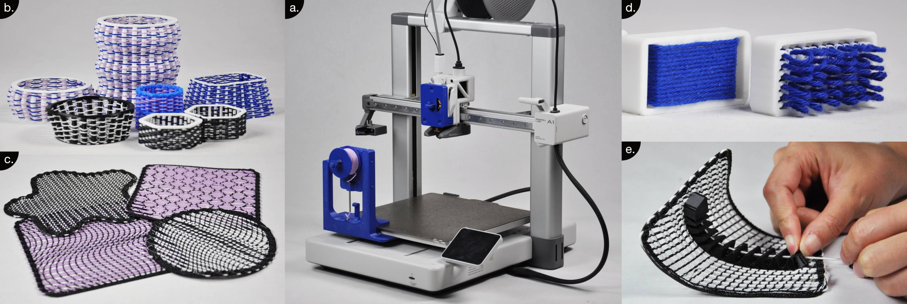

# FilaLoom: A tool changing system for automatic yarn-embedding in FDM-printing

FilaLoom is a DIY mechanism that enables FDM (Fused Deposition Modeling) 3D printers to automatically embed yarn directly into their prints. By adding a tool-changing add-on to an FDM printer, FilaLoom enables the printer to switch between depositing filament and embedding yarn. This produces objects that combine the form freedom of FDM with the softness and textile properties of yarn.

This repository contains the resources needed to build FilaLoom and begin experimenting with yarn-embedded 3D printing.

[Joram de Haas](https://orcid.org/0009-0009-9285-3978), Delft University of Technology, Netherlands, [Mehmet Ozdemir](https://orcid.org/0000-0002-5177-807X), Delft University of Technology, Netherlands, [Holly McQuillan](https://orcid.org/0000-0002-3210-1696), Delft University of Technology, Netherlands, [Zjenja Doubrovski](https://orcid.org/0000-0003-2785-3452), Delft University of Technology, Netherlands

DOI: https://doi.org/10.1145/3828611.3845661  
SCF '26: [Proceedings of the 11th ACM Symposium on Computational Fabrication](https://doi.org/10.1145/3828611), Tokyo, Japan, December 2026

## Repository contents

### FilaLoom Components STLs
Contains all printable STL files for the FilaLoom mechanism, along with a PDF assembly guide with step-by-step instructions and pictures. This version of FilaLoom is designed for the Bambu Lab A1.
### Grasshopper Scripts
Contains the Grasshopper scripts used to produce FilaLoom compatible GCode. There are five scripts in total, each corresponding to one of the print strategies discussed in the paper. The scripts are functional but are not intended as plug-and-play tools; they serve as a foundation for experimentation. Users are encouraged to adapt and build on them to develop their own yarn-embedded structures. A README inside this folder describes each script in more detail.

## Getting started

1. **Read the paper:** The preprint is included in this repository and covers the working principle, design space, guidelines, and limitations. We encourage you to read it in order to understand the full context before experimenting.
2. **Build FilaLoom:** Print the components and follow the assembly guide to build the mechanism and mount it onto your printer.
3. **Generate GCode in Grasshopper:** Open the Grasshopper scripts and start experimenting with generating your own GCode.

[Joram de Haas](https://orcid.org/0009-0009-9285-3978), Delft University of Technology, Netherlands, [Mehmet Ozdemir](https://orcid.org/0000-0002-5177-807X), Delft University of Technology, Netherlands, [Holly McQuillan](https://orcid.org/0000-0002-3210-1696), Delft University of Technology, Netherlands, [Zjenja Doubrovski](https://orcid.org/0000-0003-2785-3452), Delft University of Technology, Netherlands

DOI: https://doi.org/10.1145/3828611.3845661  
SCF '26: [Proceedings of the 11th ACM Symposium on Computational Fabrication](https://doi.org/10.1145/3828611), Tokyo, Japan, December 2026
