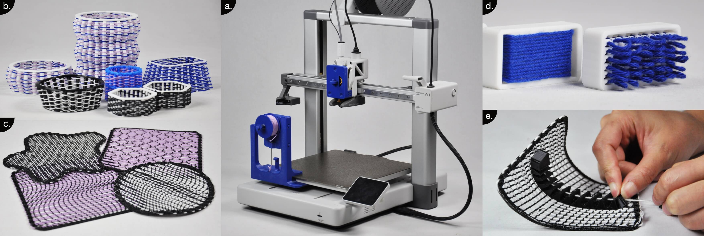

# FilaLoom: A tool changing system for automatic yarn-embedding in FDM-printing

This work showcases FilaLoom, a tool changer that enables embedding yarns directly into Fused Deposition Modeling (FDM) 3D printing. FilaLoom allows FDM-printers to switch between printing and yarn-embedding operations, enabling the automatic 'weaving' of yarns into printed objects in a multi-material fabrication process. FilaLoom is a DIY, easily implemented add-on that empowers designers and researchers with a new digital fabrication tool for printing objects with increased textileness. We explore the design space and develop several printing strategies that demonstrate how FilaLoom enables the fabrication of FDM-prints with textile-like woven structures, soft yarn textures and cable-driven interactive properties.

[Joram de Haas](https://orcid.org/0009-0009-9285-3978), Delft University of Technology, Netherlands, [Mehmet Ozdemir](https://orcid.org/0000-0002-5177-807X), Delft University of Technology, Netherlands, [Holly McQuillan](https://orcid.org/0000-0002-3210-1696), Delft University of Technology, Netherlands, [Zjenja Doubrovski](https://orcid.org/0000-0003-2785-3452), Delft University of Technology, Netherlands

DOI: https://doi.org/10.1145/3828611.3845661  
SCF '26: [Proceedings of the 11th ACM Symposium on Computational Fabrication](https://doi.org/10.1145/3828611), Tokyo, Japan, December 2026
